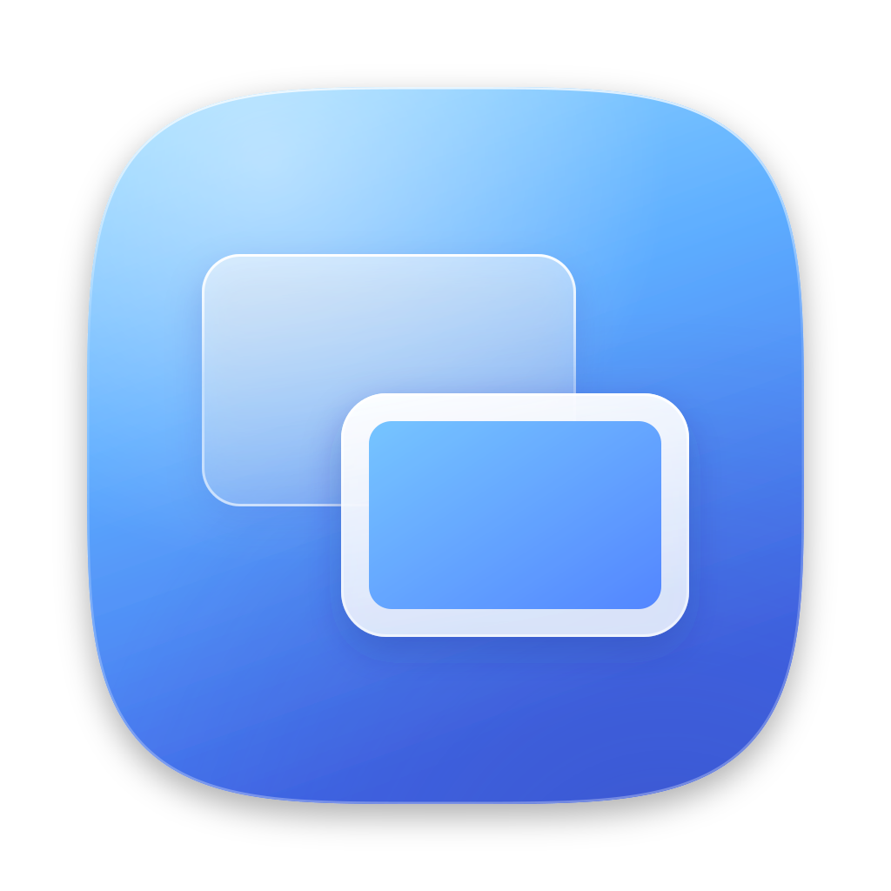

<p align="center">
  
</p>

<h1 align="center">SideTab</h1>

<p align="center">
  Use an Android tablet as a second display for your Mac, over a USB-C cable.<br>
  Free, open source, and nothing to install on the tablet.
</p>

---

Apple's Sidecar only works with iPads, and Samsung's Second Screen only works with Windows. SideTab fills the gap: plug your Galaxy Tab (or any Android tablet) into your Mac and it shows up as a real extended display. Drag windows onto it, arrange it in System Settings, unplug it and everything moves back.

## Features

- **A real extended display.** macOS sees it as a monitor, so it works with every app, Mission Control and Displays settings.
- **Plug and play.** SideTab lives in the menu bar. Plug the tablet in and the display appears; unplug it and it goes away.
- **Sharp.** Retina (2x) rendering, encoded with the Mac's hardware H.264 encoder.
- **Smooth.** 60 fps (or 30 to save power), with frame pacing tuned for Android's hardware decoders.
- **Your choice of size.** *Same as Mac* matches your Mac's screen so windows and text look the same on both; *Larger Text*, *Default* and *More Space* fit the tablet exactly.
- **Charges your tablet.** Galaxy tablets often power the Mac over USB-C instead of the other way round; SideTab switches the port so the tablet charges from the Mac, and shows its battery in the menu.
- **Wired and private.** Everything goes through the USB cable. SideTab only listens on your Mac's loopback interface, never on your network.

## Requirements

| | |
|---|---|
| **Mac** | macOS 13 Ventura or later, Apple silicon or Intel |
| **Tools** | Xcode or the Command Line Tools: `xcode-select --install` |
| **adb** | `brew install android-platform-tools` |
| **Tablet** | Android with Chrome (or Samsung Internet), and [USB debugging](https://developer.android.com/studio/debug/dev-options) switched on |
| **Cable** | A USB-C cable that carries data, not just power |

Tested on a MacBook Pro (M4) with a Samsung Galaxy Tab S9.

## Install

```bash
git clone https://github.com//SideTab.git
cd SideTab
bash build.sh install
```

This builds `SideTab.app`, copies it to Applications and opens it. Its icon appears in the menu bar.

The first time:

1. **Signing certificate.** The build creates a local code-signing certificate called "SideTab Local Signing" in your login keychain, so macOS keeps SideTab's permissions across rebuilds. macOS may ask for your password and whether `codesign` can use the key: choose **Always Allow**.
2. **Screen recording.** macOS asks to let SideTab record the screen (it needs this to send the display's picture to the tablet). Allow it in System Settings > Privacy & Security > Screen & System Audio Recording, then click **Relaunch** in SideTab's menu.
3. **USB debugging.** Plug in the tablet and tap **Allow** on the "Allow USB debugging?" prompt.
4. **On the tablet** the viewer opens in the browser. Tap **Use as Display**.

Then place the new "SideTab" display in System Settings > Displays.

## Using it

Click the icon in the menu bar:

- **Switch** – on means "become a display whenever the tablet is plugged in".
- **Resolution** – *Same as Mac*, *Larger Text*, *Default* or *More Space*.
- **Video** – frame rate (30 / 60) and quality (Balanced / High / Maximum).
- **Charge Tablet** – on: the tablet charges from the Mac (default). Off: it doesn't charge; USB-C has no neutral mode, so the tablet then powers the Mac instead.
- **Open on Tablet** – reopens the viewer if you closed it.
- **Open at Login** – start SideTab with your Mac.

To leave full screen on the tablet, swipe from the edge of the screen.

## Troubleshooting

SideTab writes a log to `~/Library/Logs/SideTab.log`; compiler output goes to `build.log`.

| Symptom | Fix |
|---|---|
| "Needs permission to record the screen" | Allow SideTab in Screen & System Audio Recording, then click **Relaunch**. If it's already on, remove it with **–**, add it again and relaunch. |
| "Unlock your tablet and allow USB debugging" | Accept the prompt on the tablet. |
| "Android platform tools aren't installed" | `brew install android-platform-tools` |
| "Port 8080 is in use" | Another copy of SideTab is running. |
| Tablet says it can't play the picture | Pick *Default* or *Larger Text*. |
| Picture feels choppy | Keep the frame rate at 60 and set the tablet's Motion smoothness to Adaptive. Add `#stats` to the address on the tablet (`http://localhost:8080/#stats`) for a live readout. |
| Tablet battery drains while plugged in | Make sure **Charge Tablet** is on; SideTab checks every 10 seconds and switches the tablet's USB port to charging. |
| Thin black bars | *Same as Mac* keeps your Mac's shape; the other sizes fill the tablet exactly. |

## How it works

```
CGVirtualDisplay → ScreenCaptureKit → VideoToolbox (H.264) → WebSocket → adb reverse → browser on the tablet (WebCodecs)
```

1. SideTab creates a virtual display. macOS treats it like a monitor you plugged in.
2. ScreenCaptureKit captures it and VideoToolbox encodes it in hardware with low-latency settings.
3. A small server on the Mac's loopback interface serves the viewer page and streams frames over a WebSocket.
4. `adb reverse` makes those ports reachable from the tablet as `localhost`, through the cable.
5. The tablet's browser decodes the video in hardware (WebCodecs) and draws it in step with the screen.

| File | Role |
|---|---|
| `Sources/SideTabApp.swift`, `MenuView.swift` | Menu bar app and its panel |
| `Sources/AppModel.swift` | When to add or remove the display; settings |
| `Sources/Resolution.swift` | Resolution, frame rate and quality options |
| `Sources/Session.swift` | One run: display, capture, encoding |
| `Sources/VirtualDisplay.swift`, `CGVirtualDisplay.h` | The virtual display |
| `Sources/ScreenCapturer.swift`, `H264Encoder.swift` | Capture and hardware encoding |
| `Sources/StreamServer.swift`, `AndroidLink.swift` | Viewer page, video socket, USB link |
| `web/index.html` | The viewer that runs on the tablet |
| `Tools/` | App icon and signing helpers |

## Limitations

- **Private API.** The virtual display uses `CGVirtualDisplay`, a private CoreGraphics API (the same one BetterDisplay and DeskPad rely on). A macOS update could break it.
- **Display only.** Touch and pen input on the tablet don't control the Mac yet.
- **Build from source.** There's no prebuilt, notarized download; you compile it on your own Mac (it takes about a minute).
- **One tablet at a time.**

## Roadmap

- Touch and S Pen input
- A native Android app for lower latency and auto-start on plug-in
- Prebuilt, notarized releases

Contributions and bug reports are welcome. Please include `~/Library/Logs/SideTab.log` with any issue.

## License

[MIT](LICENSE) © 2026 Mathias Simoens

SideTab is an independent project and is not affiliated with Apple or Samsung. Mac, macOS and Sidecar are trademarks of Apple Inc.; Galaxy is a trademark of Samsung Electronics.
